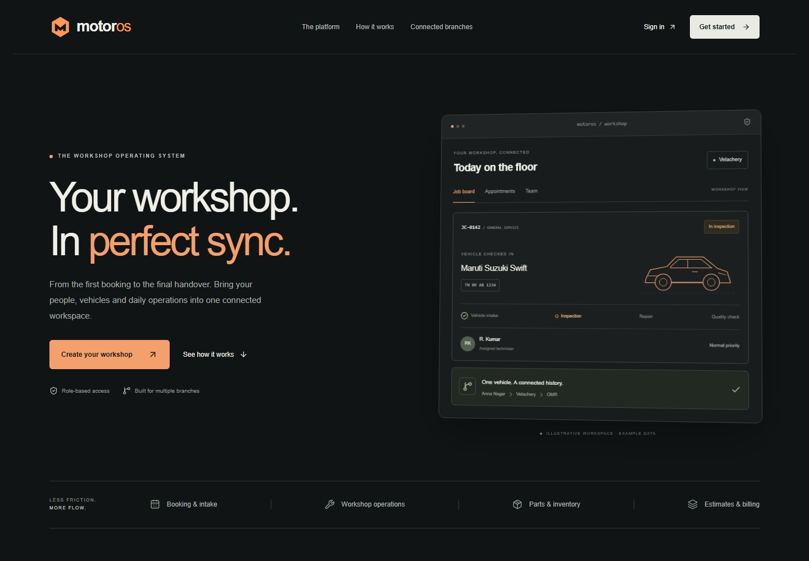
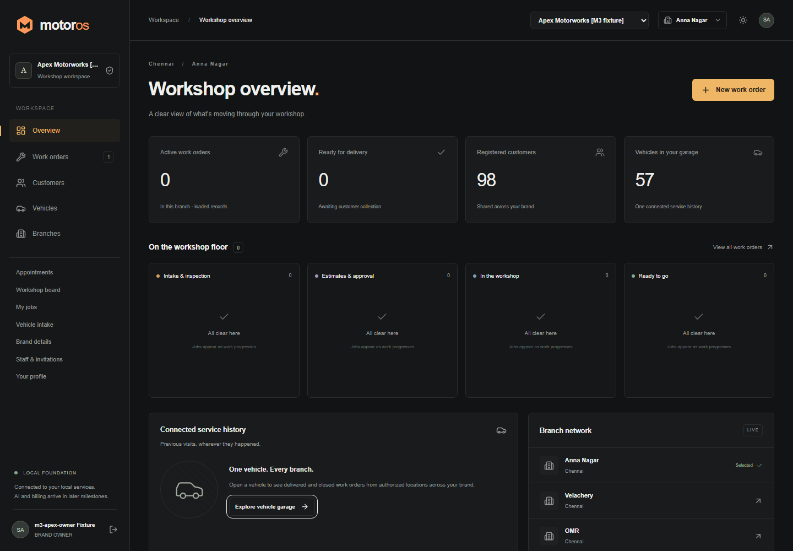
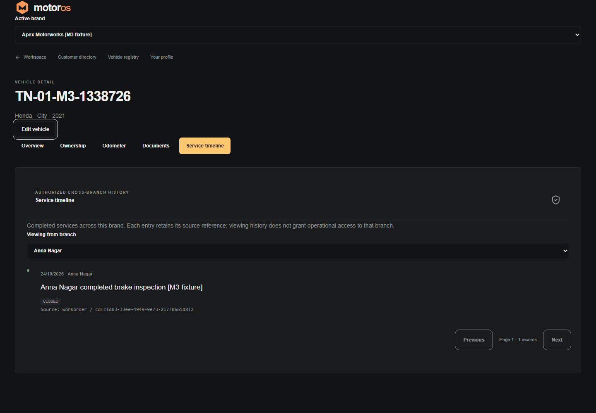
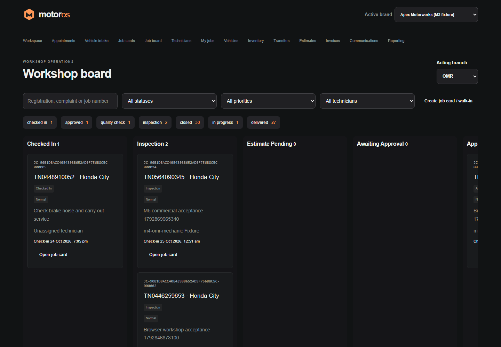
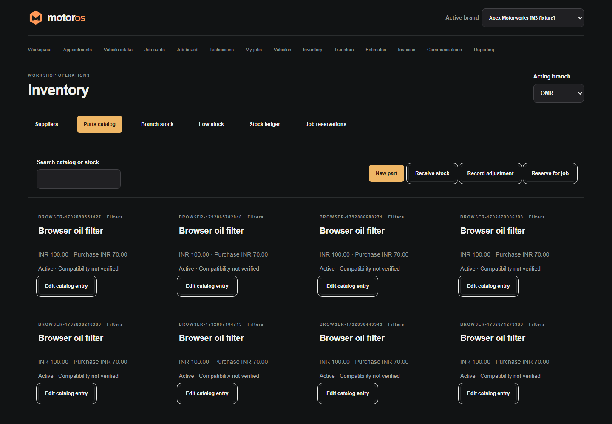
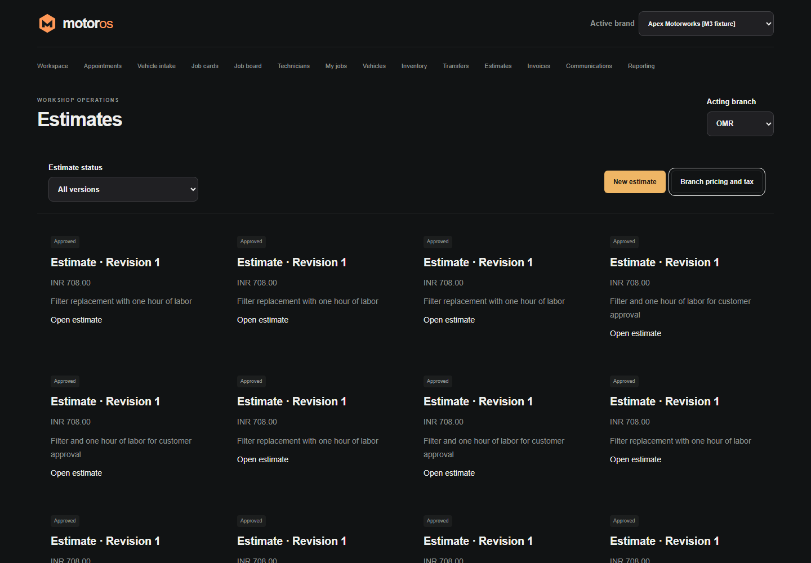
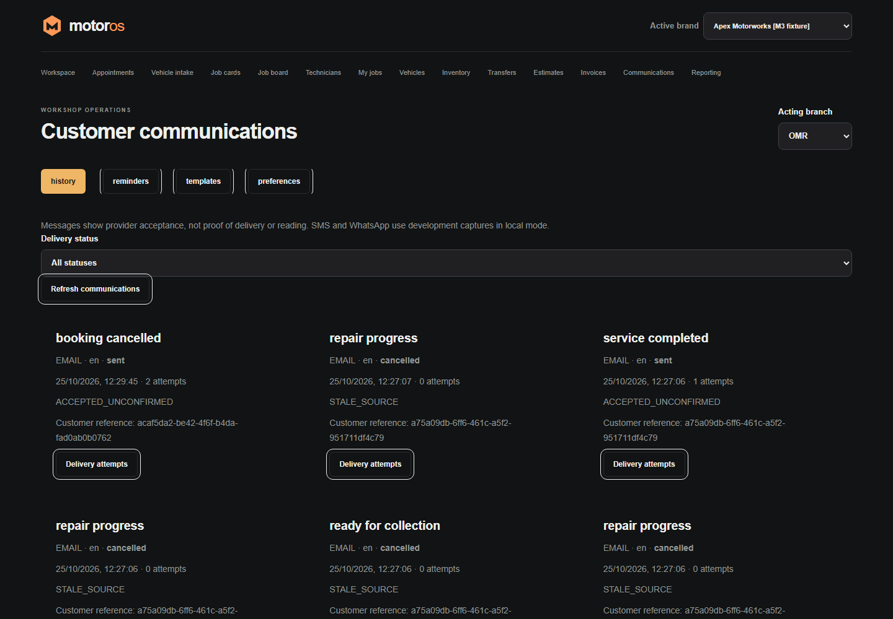
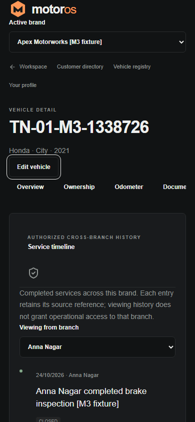
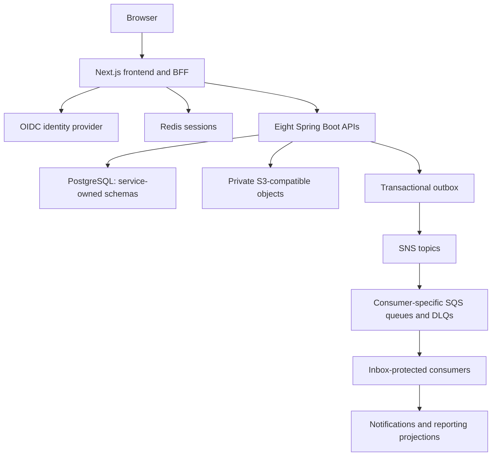

<p align="center">
  
</p>

<h1 align="center">MotorOS</h1>
<p align="center">AWS-oriented workshop software. From the first booking to the final handover.</p>
<p align="center">
  <a href="setup.txt">First-time setup</a> ·
  <a href="run_instructions.txt">Run the application</a> ·
  <a href="#screenshots">Screenshots</a> ·
  <a href="docs/milestones/MILESTONE_7_REPORT.md">Engineering status</a> ·
  <a href="#aws-preparation-and-further-documentation">AWS deployment preparation</a> ·
  <a href="LICENSE">MIT License</a>
</p>

MotorOS is a multi-tenant, multi-branch automotive workshop application. It connects customer and vehicle records, authorized service history, bookings, job cards, inspections, inventory, estimates, invoices and customer communications through eight Spring Boot services and a Next.js frontend.

**AWS target:** ECS Fargate, ECR, RDS PostgreSQL, Cognito, encrypted Valkey sessions, S3, SNS/SQS and CloudWatch, with checked-in Terraform deployment definitions. The infrastructure and release tooling are checked in; **AWS deployment is prepared, not deployed**. Start with the [AWS setup guide](docs/deployment/aws-setup.md) and [cloud architecture](docs/deployment/architecture.md).

**Current status:** working local development software with implemented Milestones 1–6 and Milestone 7 AWS deployment preparation. It is **not deployed to AWS or certified production-ready**. AI integrations remain future work. Screenshots below show actual local screens; the public landing page contains a separately labeled illustrative product preview.

## Contents

- [Application status](#application-status)
- [Features](#features)
- [Screenshots](#screenshots)
- [Technology and architecture](#technology-and-architecture)
- [Download and first-time setup](#download-and-first-time-setup)
- [Running after setup](#running-after-setup)
- [Accounts, email and demo data](#accounts-email-and-demo-data)
- [Local endpoints](#local-endpoints)
- [Development and testing](#development-and-testing)
- [Repository structure](#repository-structure)
- [Troubleshooting](#troubleshooting)
- [Security and data handling](#security-and-data-handling)
- [AWS preparation and further documentation](#aws-preparation-and-further-documentation)
- [Documentation verification](#documentation-verification)
- [License](#license)

## Application status

| Area                             | What exists                                                                                                                | Practical limit                                                                                                            |
| -------------------------------- | -------------------------------------------------------------------------------------------------------------------------- | -------------------------------------------------------------------------------------------------------------------------- |
| Identity and workshop management | OIDC sign-in, verified registration, password recovery, tenants, branches, roles and staff invitations                     | Local Keycloak; cloud identity requires separately configured deployment                                                   |
| Customer and vehicle registry    | Search, contacts, ownership history, odometer records, private documents and permitted cross-branch history                | Records are shared within a tenant; history access does not grant branch mutation rights                                   |
| Workshop operations              | Booking, check-in, job cards, tasks, assignments, inspection, quality review and operational board                         | Development-only approval paths are labeled and are not production financial approval                                      |
| Inventory and billing            | Parts, reservations, stock transfers, estimates/approvals, issued invoices and payment recording                           | Recording a payment is not a payment-gateway integration; accounting/tax configuration needs independent review            |
| Messaging and reporting          | Transactional outbox/inbox, SNS/SQS-compatible local transport, reminders, notification attempts and reporting projections | At-least-once processing; external provider acceptance is not delivery or a read receipt                                   |
| Email                            | Mailpit by default; optional Gmail SMTP for local identity emails                                                          | Gmail credentials are configured locally and never included in a GitHub download; SMS/WhatsApp remain development adapters |
| AWS deployment                   | Terraform, images, controlled release/migration tooling, IAM boundaries and operations runbooks                            | Cloud provisioning, end-to-end staging acceptance and restore exercises remain gated/unexecuted                            |
| AI                               | Structured APIs and source references suitable for future integrations                                                     | No AI Orchestrator, Mechanic Copilot or Vehicle History Summarizer is implemented                                          |

See the [Milestone 6 report](docs/milestones/MILESTONE_6_REPORT.md) and [Milestone 7 report](docs/milestones/MILESTONE_7_REPORT.md) for engineering evidence, historical test results and known limitations. Those reports describe their validation dates; they are not a claim that every suite was rerun for this documentation update.

## Features

- **Workshop and staff:** create a brand and primary branch, manage branch settings, invite employees and select an authorized workspace.
- **Customers and vehicles:** maintain a unified tenant registry, detect normalized contact/registration/VIN duplicates, retain historical ownership and avoid automatic merges.
- **Service history:** retrieve permitted completed work from originating service APIs across branches of the same tenant. Keep cross-tenant profiles, documents and history inaccessible.
- **Booking and intake:** schedule appointments, handle walk-ins, capture complaints and odometer/damage details, and create retry-safe check-ins/job cards.
- **Workshop execution:** assign technicians, manage repair tasks and inspections, track progress on the board and record quality-check/rework decisions.
- **Parts and commercial work:** manage suppliers/catalog/stock, reserve and consume parts, transfer stock, prepare estimate revisions, collect approval decisions, issue invoices and record payments.
- **Communications and reporting:** track notification requests/attempts, preferences, English/Tamil templates and reminders, with asynchronous reporting freshness.
- **Private uploads:** authorize short-lived S3-compatible upload/download URLs and validate uploaded metadata/content before publishing private documents.

Some operational screens intentionally use a simpler layout than the public landing page. Feature readiness is established by the APIs and acceptance evidence, not by a marketing preview or an older UI caption.

## Screenshots

Captured **25 October 2026** from the running local application with the current MotorOS branding. Authenticated screens use existing **synthetic development accounts and data**; no real customer records or credentials are shown. Values reflect that local fixture database and are not production statistics. Click a desktop image to view it at full size.

### Public landing page



### Workshop dashboard and authorized vehicle history

| Workshop overview                                                                                                                                                            | Vehicle service timeline                                                                                                                                                                  |
| ---------------------------------------------------------------------------------------------------------------------------------------------------------------------------- | ----------------------------------------------------------------------------------------------------------------------------------------------------------------------------------------- |
| [](docs/screenshots/dashboard.png) | [](docs/screenshots/vehicle-history.png) |

<details>
<summary><strong>View job board, inventory, billing and communication screens</strong></summary>

### Workshop board

The board uses real work-order state. Its columns scroll horizontally; the screenshot shows the visible portion of that board.



### Inventory



### Billing estimates



### Customer communications

Statuses distinguish provider acceptance, cancellation and stale source events; they do not imply a customer has read a message.



</details>

### Mobile vehicle history



Screen routes and capture details are recorded in the [screenshot notes](docs/screenshots/README.md).

## Technology and architecture

| Layer                   | Implementation                                                                                  |
| ----------------------- | ----------------------------------------------------------------------------------------------- |
| Backend                 | Java 21, Spring Boot 3.5, Maven multi-module project                                            |
| Frontend / BFF          | Next.js 16, React 19, TypeScript, same-origin server-managed authentication                     |
| Database                | PostgreSQL, eight service-owned schemas, Flyway migrations                                      |
| Identity / sessions     | Local Keycloak OIDC, PKCE, Redis-backed sessions; cloud Cognito preparation                     |
| Private objects         | SeaweedFS S3-compatible storage locally; private S3 target for AWS                              |
| Asynchronous processing | AWS SDK for Java v2, SNS fan-out, consumer-specific SQS queues/DLQs, transactional outbox/inbox |
| Local infrastructure    | Docker Compose, LocalStack SNS/SQS and Mailpit                                                  |
| Verification            | JUnit/Testcontainers, Node tests, API acceptance suites and Playwright                          |
| Cloud target            | AWS ECS Fargate, ECR, RDS, Cognito, encrypted cache, S3, SNS/SQS and Terraform                  |



Each service owns its records and migrations. Cross-service references use authorized APIs/event contracts rather than direct joins into another service's tables. Tenant/branch permissions are enforced by backend authorization; frontend visibility alone is not an access control. See [architecture overview](docs/architecture/overview.md), [identity](docs/architecture/identity-and-authorization.md) and [event reliability](docs/architecture/event-reliability.md).

## Download and first-time setup

The complete guide is [setup.txt](setup.txt). Use [run_instructions.txt](run_instructions.txt) on subsequent days.

### Prerequisites

- [Node.js](https://nodejs.org/en/download) **24** with npm, matching CI.
- [Java JDK](https://adoptium.net/temurin/releases/?version=21) **21**, with `java` and `javac` available.
- [Docker Desktop](https://www.docker.com/products/docker-desktop/) with Linux containers on Windows/macOS, or Docker Engine plus Compose v2 on Linux. Start the engine before launch.
- [Git](https://git-scm.com/downloads/) for cloning/updating and Git-history checks. ZIP extraction is an alternative for obtaining source.
- [Maven](https://maven.apache.org/install.html) **3.9.x** on macOS/Linux. Windows startup downloads and verifies its workspace-local Maven **3.9.11**.
- Internet access for initial packages, images and tools. Browser fixtures/tests additionally require Chromium and its system dependencies.

AWS credentials are unnecessary for this local setup. The default runner starts host Java/Node applications and Docker infrastructure; `docker compose up` by itself is not the full application.

### Download from GitHub

```text
git clone https://github.com/Sidtheogdeveloper/motoros.git
cd motoros
```

Alternatively, use **Code → Download ZIP** on the [repository](https://github.com/Sidtheogdeveloper/motoros), extract it completely, and open a terminal in `motoros-main`. Commands must run beside the root `package.json`, `pom.xml` and `docker-compose.yml`. ZIP archives lack Git history; Git pull and the history secret checker require a clone.

### Windows PowerShell

Select your actual Java 21 installation if it is not already configured. This path is an example, not an installed prerequisite supplied by the repository.

```powershell
$env:JAVA_HOME = 'C:\Program Files\Java\jdk-21.0.12' # replace with your JDK 21 folder
$env:Path = "$env:JAVA_HOME\bin;$env:Path"
java -version
javac -version
node --version
docker version
docker compose version
npm.cmd ci
npm.cmd run dev
```

Using `npm.cmd` avoids PowerShell's `npm.ps1` execution-policy prompt. No machine-wide policy change is part of setup. The existing dev runner invokes its local Maven helper in a separate process; if your organization's policy blocks it, use approved installed Maven and the independent workflow in the running guide.

### macOS / Linux

Ensure `java`, `javac` and Maven select Java 21. On macOS with a system-installed JDK, `export JAVA_HOME=$(/usr/libexec/java_home -v 21)` can select it. Linux installation paths vary; [setup.txt](setup.txt) shows an explicit placeholder.

```bash
node --version
java -version
javac -version
mvn --version
docker version
docker compose version
npm ci
npm run dev
```

### What startup does

The dev runner generates ignored random credentials while retaining existing values, starts and checks local infrastructure, configures OIDC, runs Java verification, prepares private storage, applies local service-owned Flyway migrations and starts eight APIs plus Next.js. First startup downloads dependencies and can take several minutes. Keep the terminal open and wait for:

```text
MotorOS ready at http://127.0.0.1:3000
```

Open **[http://127.0.0.1:3000/](http://127.0.0.1:3000/)**. Use `127.0.0.1`, not `localhost`: identity callback origins are exact.

## Running after setup

Start Docker, open the original checkout, select Java 21 and run:

```powershell
# Windows
npm.cmd run dev
```

```bash
# macOS/Linux
npm run dev
```

This convenient runner performs Java verification again; it is not a skip-tests command. It retains existing credentials and persistent workshop data. Do not reinstall dependencies or recreate fixtures on every launch.

For a faster workflow after a successful build, [run_instructions.txt](run_instructions.txt) gives exact commands for infrastructure/storage preparation, `node scripts/run-services.mjs` and `node scripts/frontend.mjs` in separate terminals. To preview a compiled frontend locally, stop its dev process, run `npm run build`, then `node scripts/frontend.mjs --production`. Do not build over a running frontend or replace running Java JARs on Windows.

Stop the normal runner with **Ctrl+C**. Optionally stop infrastructure with `docker compose down`; named data volumes remain. Do not use the volume-removal option on needed data. After a reboot, restart Docker and repeat the run command. Mailpit messages and emulator queues are temporary; they are not database backups.

## Accounts, email and demo data

### Your own account

A fresh installation has no shared default login. Choose **Get started**, register with the identity provider, follow the verification message and complete password enrollment. In the default setup, messages appear in **[Mailpit](http://127.0.0.1:8025/)**, even when you registered a real Gmail/Outlook address. Mailpit captures mail locally and does not forward it externally.

After verification, use [the login page](http://127.0.0.1:3000/login), create a workshop or accept an invitation, then select an authorized branch. Keep the frontend and identity service running while following local email links. Do not open `/api/auth/callback` manually; it belongs to an active secure sign-in transaction.

### Optional Gmail identity emails

With local Keycloak running, execute this in a separate interactive terminal:

```text
node scripts/setup-gmail.mjs
```

Enter your Gmail sender and Google App Password at the hidden prompt. It requires eligible Google App Password access and 2-Step Verification; never use your normal Google password. No developer's sender or credential is bundled in the repository. This configures **identity emails only**; workshop notifications continue using Mailpit. See [Gmail configuration, testing and rollback](docs/deployment/local-gmail.md).

### Optional synthetic fixtures

Use a dedicated local test installation with **default Mailpit identity email**, not an identity realm configured to send real Gmail messages. Install Chromium before generating fixtures:

```powershell
# Windows, in a second terminal while the app is running
npx.cmd playwright install chromium
$env:MOTOROS_DEV_FIXTURES = '1'
$env:MOTOROS_EXPECT_ASYNC_APPROVAL = '1'
npm.cmd run fixtures
npm.cmd run fixtures:m3
npm.cmd run fixtures:m4
npm.cmd run fixtures:m5
```

```bash
# macOS/Linux; Linux may need: npx playwright install --with-deps chromium
npx playwright install chromium
export MOTOROS_DEV_FIXTURES=1
export MOTOROS_EXPECT_ASYNC_APPROVAL=1
npm run fixtures
npm run fixtures:m3
npm run fixtures:m4
npm run fixtures:m5
```

Follow that order. M4/M5 fixture commands run integration scenarios and may add more synthetic records on reruns. For later communication/reporting acceptance data, `npm run test:api:m6` runs its scenarios and creates the separate synthetic platform administrator when needed; it is not an ordinary startup step.

Generated logins are in private, ignored `.runtime/m2-fixtures.json` and `.runtime/m3-fixtures.json`, with further staff data in subsequent manifests. Open them privately; do not paste them into README files or screenshots. Fixtures include Apex Motorworks (Anna Nagar, Velachery, OMR) and isolated Precision Auto Care. They demonstrate authorized same-tenant history and cross-tenant denial, not an automatic grant of access to real accounts. Older installations with legacy identities need the explicit migration policy described in the [identity architecture](docs/architecture/identity-and-authorization.md).

## Local endpoints

| Component            | Local address / port                                  | Purpose                                                             |
| -------------------- | ----------------------------------------------------- | ------------------------------------------------------------------- |
| Frontend and BFF     | [127.0.0.1:3000](http://127.0.0.1:3000/)              | User interface and same-origin API gateway                          |
| Frontend health      | [127.0.0.1:3000/health](http://127.0.0.1:3000/health) | Frontend readiness                                                  |
| Tenant Service       | 8081                                                  | Tenants, branches, memberships and authority                        |
| Customer Service     | 8082                                                  | Customers, vehicles, ownership and documents                        |
| Work Order Service   | 8083                                                  | Intake, job cards, inspection, tasks and quality checks             |
| Booking Service      | 8084                                                  | Appointments and scheduling                                         |
| Inventory Service    | 8085                                                  | Parts, reservations and stock transfers                             |
| Billing Service      | 8086                                                  | Estimates, approval, invoices and payment records                   |
| Notification Service | 8087                                                  | Delivery requests, templates, preferences integration and reminders |
| Analytics Service    | 8088                                                  | Event-driven reporting projections                                  |
| Keycloak             | [127.0.0.1:8180](http://127.0.0.1:8180/)              | Local identity provider                                             |
| PostgreSQL           | 55432                                                 | Local database; generated credentials                               |
| Redis                | 16379                                                 | Server-held sessions; generated password                            |
| Mailpit              | [127.0.0.1:8025](http://127.0.0.1:8025/) / SMTP 1025  | Local email capture                                                 |
| SeaweedFS S3         | [127.0.0.1:8333](http://127.0.0.1:8333/)              | Private object API; authentication required                         |
| LocalStack           | [127.0.0.1:4566](http://127.0.0.1:4566/)              | SNS/SQS emulator, not document storage                              |

Service health is available at `http://127.0.0.1:<service-port>/actuator/health`. Business APIs require authorization. These are loopback development endpoints, not public deployment ingress.

## Development and testing

Run commands from the root. In PowerShell use `npm.cmd` / `npx.cmd` in place of `npm` / `npx` if script policy blocks their `.ps1` shims.

| Command                     | Purpose and prerequisites                                                                                                                    |
| --------------------------- | -------------------------------------------------------------------------------------------------------------------------------------------- |
| `npm run dev`               | Full local startup, Java verification and frontend dev server                                                                                |
| `npm run infra`             | Prepare/check infrastructure and local identity configuration                                                                                |
| `npm run storage:configure` | Configure/check the private local bucket after the Java build                                                                                |
| `mvn verify`                | Java/JUnit/Testcontainers with JDK 21, installed Maven and Docker; Windows full startup also runs Java verification through its local helper |
| `npm run test:unit`         | Node unit checks                                                                                                                             |
| `npm run typecheck`         | Frontend TypeScript checks                                                                                                                   |
| `npm run build`             | Production frontend build; stop a running frontend before switching build modes                                                              |
| `npm run test:api`          | M2–M5 provider/API acceptance; requires live services, Chromium and ordered fixtures                                                         |
| `npm run test:api:m6`       | Messaging/notification/projection acceptance and M6 fixture preparation                                                                      |
| `npm run test:reliability`  | Controlled local broker/SMTP failure tests; explicit opt-in required                                                                         |
| `npm run test:e2e`          | Playwright browser suite; live app and M2–M6 manifests required                                                                              |
| `npm run test:secrets`      | Source/generated-secret and reachable Git-history checks; requires a Git clone                                                               |
| `npm run export:openapi`    | Refresh versioned API snapshots from the running services; this can change tracked contracts                                                 |

After preparing fixtures on a dedicated local Mailpit installation, use the same terminal with the fixture/async flags still set:

```powershell
# Windows
npm.cmd run test:api
npm.cmd run test:api:m6
$env:MOTOROS_FAILURE_TESTS = '1'
npm.cmd run test:reliability
npm.cmd run test:e2e
```

```bash
# macOS/Linux
npm run test:api
npm run test:api:m6
MOTOROS_FAILURE_TESTS=1 npm run test:reliability
npm run test:e2e
```

These suites create/update synthetic records; failure tests temporarily stop named local infrastructure and restore it. Run them on a test stack, not a personal-data installation or cloud environment. Full browser registration tests expect Mailpit identity email. Historical tests under `tests/legacy/` are excluded from the current scripts.

Additional database/container checks include `node tests/integration/fresh-compose.mjs`, `node tests/integration/cloud-migrations.mjs` and `node tests/integration/keycloak-permissions.mjs`. They require Docker and prepared build prerequisites; see the [CI workflow](.github/workflows/verify.yml) and milestone reports for their execution order. A local production build, container build or prepared cloud test is not proof of a deployed AWS environment.

## Repository structure

```text
apps/workshop-dashboard/        Next.js UI, BFF, shared branding and tab icons
services/                      Eight independently buildable Spring Boot APIs
packages/service-security/     JWT validation, trusted delegation and authorization
packages/service-foundation/   Service-owned helpers, event contracts and reliability
packages/object-storage/       Authorized private object-storage integration
packages/api-contracts/        Shared frontend contracts and OpenAPI snapshots
infrastructure/docker/         Local database setup, health probes and runtime image
infrastructure/keycloak/       Local MotorOS identity-provider branding
infrastructure/terraform/      Unapplied cloud environment/modules and deployment targets
scripts/                       Startup, fixture, storage, identity and verification tools
tests/                         Unit, API, browser, migration and reliability checks
docs/architecture/             Service ownership and workflow decisions
docs/milestones/               Engineering reports and historical validation evidence
docs/deployment/               Cloud preparation, email and operations runbooks
docs/screenshots/              Current synthetic-data application screenshots
setup.txt                      Download and first-time setup
run_instructions.txt           Everyday startup, shutdown and troubleshooting
```

Architecture details: [customer/vehicle registry](docs/architecture/customer-vehicle-registry.md), [workshop operations](docs/architecture/workshop-operations.md), [commercial operations](docs/architecture/commercial-operations.md), [permission matrix](docs/architecture/role-permission-matrix.json) and [branding](docs/product/branding.md).

## Troubleshooting

| Symptom                                       | Check / resolution                                                                                                                                                            |
| --------------------------------------------- | ----------------------------------------------------------------------------------------------------------------------------------------------------------------------------- |
| Site cannot be reached                        | The frontend may be stopped. Start the full app, keep its terminal open and wait for the ready message. Backend-only or Docker-only startup is insufficient.                  |
| Page loads but login/data fail                | Check all eight backends, Keycloak and Redis; inspect `.runtime/logs/` locally and `docker compose ps`.                                                                       |
| PowerShell blocks `npm.ps1` or a setup `.ps1` | Use `npm.cmd`, `npx.cmd` and the Node Gmail setup prompt. Do not change machine-wide execution policy. For Maven policy restrictions use approved installed Maven.            |
| No verification message in Gmail/Outlook      | Fresh setup uses Mailpit. Check port 8025. Only explicitly configured Gmail identity transport sends externally; check Inbox/Spam and use resend.                             |
| Verified account returns to a failed callback | Verification/password setup may already be complete. Visit `/login` to start a new sign-in. Administrative action emails should return to `/login`, not `/api/auth/callback`. |
| Authentication redirect fails using localhost | Use `http://127.0.0.1:3000` consistently. Do not broadly loosen provider redirect allowlists.                                                                                 |
| Port already occupied                         | Stop the previous MotorOS runner. Identify the owner before touching unrelated processes; do not launch both startup workflows together.                                      |
| Wrong Java or missing Maven                   | Check `JAVA_HOME`, `java -version`, `javac -version` and `mvn --version` on platforms using installed Maven.                                                                  |
| Empty workshop / access denied                | Select a permitted tenant/branch. A new personal account must create a workshop or accept an invitation. Demo data is optional.                                               |
| New logo/tab icon not visible                 | Hard-refresh: Ctrl+Shift+R, or Cmd+Shift+R on macOS.                                                                                                                          |
| Mailpit messages disappeared                  | Its local mailbox is temporary. Resend an unfinished action; do not bypass verification.                                                                                      |
| Download/build fails                          | Check Docker/network/proxy availability. Do not disable TLS validation or publish secrets in diagnostic logs.                                                                 |

For Git updates, stop app runners, preserve local edits/configuration, check `git status`, then use `git pull --ff-only`, reinstall lockfile dependencies as needed and restart through the full dev workflow. Review migration notes and back up needed data before upgrades; code rollback does not reverse database migrations. ZIP downloads are not a managed update mechanism for an existing private installation.

## Security and data handling

- OIDC uses PKCE, server-held tokens, HTTP-only session cookies and same-origin mutation checks. Local runners explicitly allow HTTP/loopback development; production requires HTTPS and secure configuration.
- Trusted backend membership/permission checks protect tenant and branch boundaries. A client-provided branch or event payload is not an authorization grant.
- `.env` and `.runtime/` contain private credentials, realm imports, fixture logins and logs. They are ignored. Never commit them, Terraform state/plans, tokens, browser sessions or screenshots containing secrets.
- Preserve credentials consistently with the database and object volumes. Deleting `.env` while retaining an initialized database can break service credentials.
- Uploads use private objects, short-lived grants and metadata/content validation. MIME/signature checks are not malware scanning; production retention and scanning require their own review.
- Duplicate delivery is possible; outbox/inbox protection addresses processing idempotency. External messaging without provider idempotency cannot claim exactly-once delivery.
- Do not expose local database, identity, mail, object-storage or emulator ports to the internet. Do not use development fixtures or approval switches in production.

The [security review](docs/deployment/security-review.md) and [identity architecture](docs/architecture/identity-and-authorization.md) provide further controls and limitations. The public issue tracker can be used for general bugs; redact private data and credentials from any report.

## AWS preparation and further documentation

Milestone 7 prepares private application deployments, Cognito, encrypted database/cache/storage, service discovery, messaging, controlled migrations, digest-based releases, observability and recovery tooling. **No AWS resources or ECR image publications are created by local setup.**

Provisioning remains gated on a working non-root deployment role/account, real domain/certificate inputs, verified SES setup, budget and alert contacts, reviewed Terraform plan and explicit deployment approval. Production requires its own review. Prepared smoke, rollback and restore tooling has not established successful staging deployment or measured cloud recovery.

- [Milestone 2 — Identity and workshop authority](docs/milestones/MILESTONE_2_REPORT.md)
- [Milestone 3 — Customer and vehicle management](docs/milestones/MILESTONE_3_REPORT.md)
- [Milestone 4 — Workshop operations](docs/milestones/MILESTONE_4_REPORT.md)
- [Milestone 5 — Inventory and billing](docs/milestones/MILESTONE_5_REPORT.md)
- [Milestone 6 — Messaging and reliability](docs/milestones/MILESTONE_6_REPORT.md)
- [Milestone 7 — AWS deployment preparation](docs/milestones/MILESTONE_7_REPORT.md)
- [AWS setup](docs/deployment/aws-setup.md), [deployment architecture](docs/deployment/architecture.md), [CI/CD](docs/deployment/ci-cd.md)
- [Environment configuration](docs/deployment/environment-variables.md), [cost-estimation method](docs/deployment/cost-estimation.md), [disaster recovery](docs/deployment/disaster-recovery.md)

The existing cost snapshots are dated estimates, not a current bill or a deployment budget approval. AI implementation and Milestone 8 remain outside this documentation update.

## Documentation verification

This documentation update was checked on **25 October 2026 (Asia/Calcutta)** against the implemented startup scripts, package commands and CI workflow. The existing Windows local app was reachable, and all eight current screenshots were captured after real sign-in using verified synthetic accounts. Screenshots do not establish that every feature or failure mode was retested.

| Check for this update                        | Result                                                                              |
| -------------------------------------------- | ----------------------------------------------------------------------------------- |
| Documentation references                     | 62 local links/anchors and 58 npm command occurrences validated                     |
| Screenshot files                             | Eight PNGs visually reviewed; about 365 KiB total                                   |
| Current local readiness                      | Frontend plus all eight backend health checks returned HTTP 200                     |
| Safe browser regression checks               | Five passed: public pages, branding, mobile layout and existing OIDC/workspace flow |
| Node unit checks                             | 19 passed                                                                           |
| Compose configuration / patch formatting     | Passed                                                                              |
| Source and reachable Git-history secret scan | No findings                                                                         |

Fresh-machine installation, macOS/Linux execution and AWS acceptance were **not** repeated for this documentation-only update. Previous build/API/reliability results belong to the linked milestone reports. Instructions do not migrate local customer data or publish private installation settings to GitHub.

## License

MotorOS source is available under the [MIT License](LICENSE). Third-party dependencies and external services retain their own terms.
