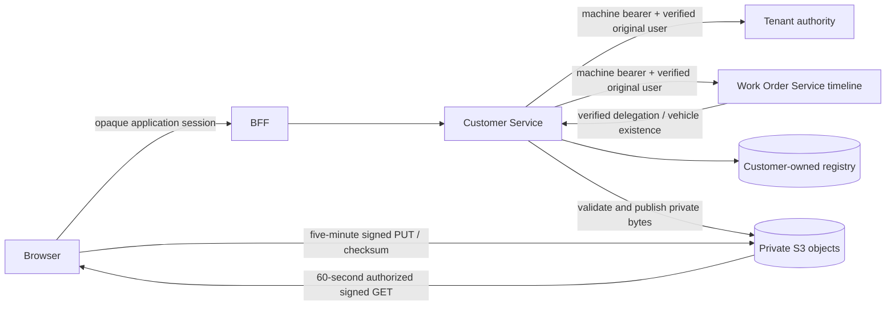

# Customer and vehicle registry

Customer Service owns customers, contacts, vehicle identities, current/historical ownership, odometer readings, document metadata and registry audits in its `customer` schema. Work Order Service owns operational and completed service records. Neither reads the other's tables.

## Identity, duplicates and ownership

All resources are tenant scoped. Live Tenant membership checks and explicit permissions remain mandatory on every API request, including delegated history calls and document grants. Vehicles/customers are shared within a brand; branch context authorizes operations and the point from which staff read completed history. A permission alone never grants another tenant's records.

Customers normalize trimmed/lowercase email and phone punctuation. Indian 10-digit numbers normalize with country code 91 when country is India/IN; international contacts use explicit country-code digits. Additional contacts participate in search/duplicate detection. Duplicate people can be intentionally retained only with an explicit review reason. Vehicles normalize punctuation/case from registration and uppercase VIN (17 characters excluding I/O/Q). Unique indexes are tenant scoped, so different workshops may hold independent records for the same real-world vehicle. No merge endpoint exists.

The V2 migration flags ambiguous pre-existing normalized registrations instead of dropping or merging records. Their owners/vehicles survive; a corrected unique registration clears the conflict flag after explicit editing. Tenant advisory transaction locks serialize duplicate checks, transfers and odometer append decisions; unique indexes protect vehicle identities/current ownership. Customer/vehicle mutations use optimistic versions. Ownership transfer closes the prior relationship, starts a new one and updates current owner atomically, retaining history/reason/actor. Transfer is effective now; backdated ownership correction is deferred.

Mechanics can find vehicle identity and technical service history but responses omit customerId and deny customer profiles, ownership lists and customer-private documents. Contact-access staff with ownership permissions can inspect previous owners. CUSTOMER remains reserved; a personal customer portal/identity linkage is not implemented.

## Timeline and future AI consumers

`GET /api/vehicles/{id}/timeline?branchId=...&page=...&size=...` in Customer Service delegates to the matching Work Order-owned API with both authenticated machine identity and the original signed user token. Work Order independently reauthorizes membership/branch/history permission, verifies vehicle access through Customer's API and returns only delivered/closed same-tenant records. Failure is 503, never fabricated empty history. Results include source service/resource/path, branch, status, timestamps and summary. Odometer and ownership are separately paginated typed resources.

Future AI features must call these same authorized APIs, propagate actual user context, retain source references, and treat record text as untrusted data rather than instructions. Source references identify evidence; they do not grant operational access to the originating branch. No AI service or orchestrator is introduced.

## Private document protocol

1. An authorized writer identifies the customer/vehicle, assigned branch, safe filename, allowed media type, 1 byte–10 MB size, SHA-256 digest and visibility. The API validates scope and metadata, creates a pending record, and signs a unique staging key for five minutes.
2. The browser uploads bytes directly to S3 using the returned signed headers/checksum. CORS permits the exact local application origin, not arbitrary sites.
3. Completion reauthorizes writer/branch, locks/version-checks the record, enforces expiry, verifies actual length/hash/PDF-PNG-JPEG magic, and writes verified bytes to a separate publication key. Only then can the document be listed/downloaded. Replaying a staging PUT cannot replace an already published file.
4. A download request rechecks current membership and document visibility, audits the grant, and signs an attachment GET for 60 seconds. URLs are bearer capabilities during their short lifetime. Browser upload/download fetches omit application credentials, including on the loopback storage port; downloads use attachment blobs. Archive is a versioned metadata change; it prevents new grants and retains the object for retention review.

Database metadata never exposes object keys or hashes in lists; no permanent URLs, public ACLs or localStorage credentials are used. Object keys contain tenant/document UUIDs and random components. Pending keys have lifecycle expiry; failed publication transactions may leave unreachable orphan objects, so production reconciliation/retention must be implemented before public rollout. MIME magic is not a full parser, sanitization or malware scan. Production untrusted uploads need a scanner/quarantine workflow. ASCII filenames deliberately simplify safe attachment headers.

Local SeaweedFS runs with generated credentials, authenticated access, persistent named storage and only port 8333 published to loopback. Its unsupported AWS public-access-block API is explicitly distinguished from its verified anonymous access denial. LocalStack was rejected for private documents after an unsigned GET returned 200. Local storage is development infrastructure, not a production object-store recommendation or an at-rest encryption claim.

## AWS configuration readiness

No AWS resource was created. For an approved deployment leave S3_ENDPOINT/S3_PUBLIC_ENDPOINT unset, set S3_BUCKET and S3_REGION, and use an IAM task role through the SDK default credential chain. Publication requests use SSE-S3 AES256. Configure bucket-wide public access blocking, TLS-only access, encryption, exact production CORS, lifecycle/retention, backup/restore and monitoring outside the runtime application. The runtime role needs object Put/Get on its uploads/documents prefixes and Delete on staging; it should not manage bucket policy or IAM. KMS/AV/retention policy and actual AWS S3 integration remain unverified.

For container-local development set S3_ENDPOINT=http://storage:8333 and S3_PUBLIC_ENDPOINT=http://127.0.0.1:8333 with generated local keys. For host processes both resolve to loopback. The BFF CSP uses S3_UPLOAD_ORIGIN (default loopback); set the exact HTTPS S3 upload origin at production build time. Do not copy local keys or OIDC insecure-loopback flags into a deployment.

Registry/audit logs retain actor, tenant, branch, target, event, outcome, timestamp and propagated correlation. Customer contact contents and signed URLs are excluded from access logs. Work Order V2 persists correlation on timeline access and order audits.

References: [AWS presigned URLs/checksums](https://docs.aws.amazon.com/AmazonS3/latest/userguide/using-presigned-url.html), [SeaweedFS authenticated local startup](https://github.com/seaweedfs/seaweedfs/wiki/Quick-Start-with-weed-mini).
