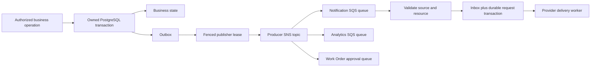

# Event-driven reliability

## Ownership and deployment

The existing six services remain authoritative. Notification (8087, `notification_app`/`notification`) owns communication delivery; Analytics (8088, `analytics_app`/`analytics`) owns reporting projections. All eight are independently buildable Spring Boot applications. Workers run within their owning service and can be independently scaled with the same image/configuration; inboxes, row claims and schedules support competing instances. Business services never query another service's schema. Existing REST paths and live Tenant authorization remain available.



AWS SDK for Java v2 SNS/SQS uses version 2.57.3, matching the existing S3 adapter. Production uses workload credentials and the SDK's HTTPS endpoints. The local endpoint uses emulator-only credentials and is restricted to loopback/`localstack`; no AWS credentials are needed. Local topology bootstrap is refused against a non-emulator endpoint.

## Contract and source authority

The authoritative JSON schema is `packages/api-contracts/events/envelope-v1.schema.json`. Envelopes include event/type/version, tenant/optional branch, aggregate type/ID/sequence, UTC occurrence time, correlation/causation, producer and a typed minimal payload. UUID/resource relationships, event version/producer/type, date formats, decimal strings and allowed payload fields are validated by the Java record. Unknown required versions, malformed metadata and unexpected producers are rejected.

Aggregate versions are source-owned event sequence numbers, not the resource's optimistic-lock counter; `payload.resourceVersion` retains that counter separately. Versions serialize through an owned primary key in the business transaction. Independent event types for one aggregate share its sequence. Monetary amounts and quantities are exact strings on the bus.

Names, contact details, complaints, notes, addresses, approval tokens, signed URLs and rendered message bodies are excluded. Existing M5 `PartReserved`/`PartConsumed`/`PartReservationFailed` names are translated to canonical plural transport names; persisted audit naming remains compatible. Auxiliary draft, release, reconciliation and transfer-status contracts are explicit. `ProjectionSnapshot` is an authenticated reconciliation-feed record, held off the SNS bus; it does not trigger historical notifications.

SNS envelopes retain TopicArn metadata. Queue policies restrict SNS delivery to the configured producer topic/account. Consumers additionally compare the complete event with a committed source-event proof obtained using an OIDC machine token. A public user token cannot call those narrow `/api/automation/` endpoints. Producer/resource/tenant relationships are checked again against the owning records. Normal machine delegation still requires the original user for ordinary REST actions; no stored user bearer token is reused by workers.

Customer communication context is resolved only for an event whose source/customer linkage matches the requested customer. Billing exposes an approval body only to the Notification machine for a current pending recipient-bound estimate. Recipient changes cause cancellation rather than delivery to a different person. No event grants a role or branch membership.

## Topics, queues and retry policy

There is one standard topic per producer: tenant, customer, booking, workorder, inventory, billing and notification, named `<prefix>-<producer>-v1`. Notification and Analytics each have their own queue subscribed to those topics. Work Order has an independent Billing subscription, `<prefix>-workorder-approval-v1`. Consumers ignore known unrelated types after envelope validation. An ignored event cannot create a business side effect.

Each queue has a separate DLQ. Defaults: 60-second visibility, five receives, four-day main retention and fourteen-day DLQ retention. Queue long polling is configured for 20 seconds; worker receives use a two-second bounded poll and batches of five to keep shutdown/pause responsive. Transient processing failures delay visibility using exponential backoff plus jitter; invalid schema/source/ownership failures are quarantined immediately. Provider rate limiting (429) is transient. Permanent failures are not retried forever.

Outbox publishers claim five rows with SKIP LOCKED and a 120-second token-fenced lease, commit the claim, then publish outside the database transaction. Broker operations have a fifteen-second total timeout; the batch budget fits the lease. Acknowledged publishes alone become PUBLISHED. Failures retain attempt counts, safe categories and bounded exponential delay/jitter. An expired claim is reclaimable; its old token cannot mark another owner's work published. A crash after broker acknowledgment can still duplicate a publication.

Inbox uniqueness is `(consumer,eventId)`, with a canonical content hash and tenant binding. An ID reused with different content/tenant is rejected. The handler's database writes and successful inbox entry commit together. SQS deletion follows commit. A transaction failure or abandoned receipt leaves the message retryable. These are at-least-once delivery and idempotent business effects, not exactly-once transport.

## Producer transaction integration

Booking, Work Order, Tenant and Customer use schema-owned PostgreSQL lifecycle triggers. This preserves transaction atomicity for both current and legacy REST mutation paths. Trigger functions have fixed owned search paths and are not SECURITY DEFINER. Inventory and Billing retain their existing transaction-bound outbox writes, enriched by an owned normalization trigger. Existing applied migrations were preserved.

Work Order emits completion at the documented repair-completed/QUALITY_CHECK step. That event does not certify quality, invoice issue, payment or collection readiness. READY_FOR_DELIVERY and DELIVERED have separate events. Inspection completion is a recorded workshop observation, not a safety certification.

EstimateApproved is consumed by Work Order. The consumer resolves the current Billing decision, latest estimate, expiry and tenant/customer/vehicle/work-order links; locks its own job; and updates only eligible states and approval references. Source event, system actor and correlation are audited. An old decision cannot replace a later revision. Existing repair-start/task/consumption financial checks remain authoritative. Payment, invoice and inventory events are reporting/notification inputs; consumers do not create a second ledger transaction or stock deduction.

## Notifications, privacy and scheduling

Customer Service owns email/SMS/WhatsApp flags, operational/optional consent, English/Tamil preference, versioning and consent audit metadata. Existing customers default to operational email enabled, optional communications disabled and SMS/WhatsApp disabled; deployments must review their communication policy and existing consent before enabling real delivery. Staff preference changes require a dedicated permission. A customer identity may access only the preference record whose email matches its provider-verified email.

Notification owns versioned English/Tamil templates, unique source/channel/template requests, encrypted recipient/content references, attempt history and persistent schedules. The built-in templates are deployment-managed, not editable across tenants by workshop users. Staff APIs expose safe metadata and resource IDs. Sensitive cached content is removed after acceptance/cancellation. Failed requests retain encrypted content for an explicitly authorized retry.

Local email is captured by Mailpit; local recipients must use `example.test`. SMS and WhatsApp adapters are explicit local sinks and cannot send to real providers. Nonlocal SMS/WhatsApp attempts fail closed until a provider is configured. SENT means provider acceptance (`ACCEPTED_UNCONFIRMED`) or explicitly labeled `DEVELOPMENT_CAPTURED`; no delivery/read receipt is invented. Receipt storage exists for future authenticated provider callbacks. SMTP has no idempotent-send API: a process crash after acceptance and before recording success can cause duplicate email. A stable Message-ID assists diagnosis but does not eliminate that window.

Billing's legacy approval mail worker is disabled while event messaging is enabled, so Notification owns delivery of the secure approval body. The existing hashed, expiring, recipient-verified, exact-version approval workflow remains unchanged. Tokens do not enter the bus or staff history APIs.

Booking owns durable appointment timer rows and emits AppointmentReminderDue only for a still-confirmed, future, unchanged appointment. Notification keeps a schedule/history view and handles the resulting event. Other reminders use persistent Notification rows. Row locks, unique source/resource/template keys and current-state/consent checks occur before enqueue and again before provider send. Rescheduling/cancellation invalidates old jobs. Collection reminders require current readiness; estimate reminders require a current pending unexpired estimate; outstanding payment reminders require a positive current balance and an authorized scheduling action. Maintenance follow-up is optional and consent-controlled, not a manufacturer schedule.

## Reporting and reconciliation

Analytics stores one current source-verified snapshot per tenant/producer/aggregate. Only a higher event sequence replaces it, or the identical event at the same version repairs a lost/corrupt row. Standard-queue reordering and version gaps cannot overwrite newer state. Reporting views compute bookings, repair completion/turnaround, issued invoices, separately defined manual net collections, pending approvals, consumed quantities and notification outcomes. Currency groups remain separate.

Each producer periodically compares its own current records with an owned fingerprint table, materializing bounded reconciliation snapshots for pre-event records or missed hooks. Sensitive raw fields are stripped before storage. Analytics scans a bounded authenticated source feed, rechecks source proofs, updates checkpoints and periodically cycles the feed. Reapplying verified snapshots repairs deleted projections even if an inbox entry already exists. Initial historic backfill is gradual; freshness and eventual consistency are shown in the UI, and a quiet projection is not advertised as real-time completeness.

## Local broker restart recovery

The free LocalStack image has ephemeral broker state. No paid persistence feature or credentials are required. In local mode only, each producer durably records the Notification queue creation generation. If that generation changes after topology restoration, it requeues PUBLISHED business outbox entries from the last fourteen days. Existing inboxes suppress previously applied effects; unconsumed committed events recover. Reconciliation-only snapshots remain off the bus. Competing instances serialize generation changes with an owned database lock. This is application-assisted local replay, not a claim that the emulator itself persists SQS data or reproduces all AWS failure behavior.

Production does not run this emulator-generation poll or create queues/topics. AWS SQS durability, encryption, permissions, key policy and production failure behavior require deployment validation. Source proof/inbox retention must exceed queue/DLQ/replay horizons. Current code retains these records; a deployment retention job must preserve at least 365 days of source proofs supporting the maximum one-year reminder schedule, and retain inboxes longer than any allowed replay window. No automatic destructive cleanup is enabled.

## Administration and observability

Only live platform administrators can inspect `/api/platform/messaging` health, queue metadata and safe failure metadata, pause/resume consumers, resolve failures or redrive stored events. All mutations require an audit reason. Replay re-enters the same source/tenant validation and inbox path. Workshop roles cannot access those diagnostics or raw messages. Pause drains existing handlers; it does not bypass processing rules. A restart resumes configured consumers.

Structured logs retain event/correlation/category/attempt identifiers without recipients/bodies. HTTP transaction trace context is persisted with outbox records. OpenTelemetry/Micrometer observations create publish/consume spans and propagate trace context in SNS attributes; event IDs/correlation are span metadata. Metrics cover backlog, oldest outbox age, publication/consumer failures, event lag, local replay and observation latency; notification attempts/outcomes are durable queryable records. Queue depth/inflight/DLQ metadata is available to platform admins; AWS/SQS provides production queue-age metrics. Attach an approved ADOT/OpenTelemetry exporter/collector for centralized CloudWatch/X-Ray/OTLP collection; no cloud telemetry account was configured locally.

The unapplied Terraform messaging module prepares encrypted topics/queues, source-scoped queue policies and configurable SQS backlog/age alarms. Operational initial thresholds: any DLQ backlog for two minutes; queue age over 300 seconds for three periods; outbox age over 120 seconds for five minutes; repeated provider/publisher failures or consumer error spikes for five minutes. These are starting operating targets, not service guarantees. Tune for workload/SLOs and configure alert destinations explicitly. Monitor service availability independently from idle queue metrics. IAM policy generation and production release gates are described beside the Terraform module.

## Verification commands

Run the existing Java/Node/type/build/API/browser suites. With the app and fixtures running:

```powershell
$env:MOTOROS_DEV_FIXTURES='1'
npm run test:api:m6
$env:MOTOROS_FAILURE_TESTS='1'
npm run test:reliability
node tests/integration/fresh-compose.mjs
```

Failure tests are hardwired to the named local Docker containers and loopback database, use synthetic records, restore stopped providers/broker/consumer state in finally blocks, and do not access AWS. The receiver-abandonment test pauses the real consumer, lets an independent receive subprocess exit without acknowledging, then resumes the real worker after visibility expiry. JUnit separately covers failed-transaction rollback, abandoned publisher claims, post-commit duplicates, concurrent claims and event identity mismatch. This does not claim exhaustive ECS process-kill, network-partition, load/soak or disaster-recovery coverage.
