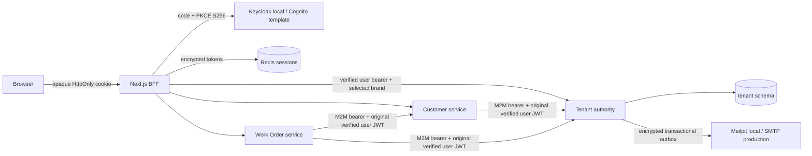

# Identity and authorization

Identity is immutable `(issuer, subject)`. Provider claims authenticate; Tenant database memberships authorize. Permission checks re-read active users, brands, memberships and branch assignments on every request. No user authorization cache exists, so a still-valid access token loses resource access on the next request after membership deactivation. The UI refreshes authority every five seconds and immediately when a request is denied. New branches do not require login. In-flight reads admitted before a revocation may finish; membership mutations lock the brand and recheck authority within their transaction.

The BFF performs discovery, code exchange, PKCE/state/nonce and ID-token verification with openid-client. Login transactions expire in five minutes and are consumed atomically. Eight-hour application sessions use random opaque cookies, hashed Redis keys and AES-256-GCM encrypted server values. Access tokens expire after five minutes; rotating refresh tokens stay server-side. Refresh has a per-session distributed lock and compare-and-swap updates to preserve brand selection and prevent resurrection after logout. Redis/session failures deny access. Cookies are HttpOnly, SameSite=Lax for the cross-site OIDC redirect and Secure in production. State-changing BFF requests require the exact Origin. Backends accept bearer tokens only and do not authenticate browser cookies.

The BFF checks accessible membership before changing the server-stored active brand. Each scoped request also carries an expected-brand guard: a stale tab receives 409 if its brand differs from the session. This header never authorizes a tenant. URL tenant IDs must match the authenticated selection; controllers and SQL enforce tenant predicates. Query keys include user, tenant, permission context and branch where relevant. Branch operational access uses assigned active branches. Same-brand completed vehicle history requires VEHICLE_HISTORY_READ; its location directory exposes only branch ID/name, not contacts or staff for other branches.

All services independently verify RSA signature through JWKS, issuer, expiration, issued-at, intended audience/client, token use and required scopes. Cognito access tokens use allowlisted client_id + token_use=access when audience is absent. Provider groups/roles are not accepted as MotorOS authority. Internal endpoints require an allowlisted confidential machine client, internal scope and independently validated original user JWT. Both identities are checked; arbitrary tenant/user headers do not grant access. Customer and Work Order fail closed when Tenant cannot resolve authorization. Correlation IDs propagate through internal requests.

The explicit role matrix is [role-permission-matrix.json](role-permission-matrix.json). Owners have tenant scope; managers and operational staff have branch assignments. Platform administration is a database-controlled user flag with dedicated status/list endpoints, and does not grant implicit business-data access. CUSTOMER has no staff API grants; personal customer/vehicle ownership linkage and portal are deferred. Future AI callers must reuse these checks and authenticated delegation rather than invent an internal bypass.

Invitations use 256-bit secrets, SHA-256 hashes, 24-hour expiry, fresh provider-verified email matching, inviter authority revalidation and atomic single consumption. Resend invalidates the old secret; revoke blocks acceptance. Encrypted outbox payloads commit with the invitation; SMTP sends retry at most five times, clear content after success and show delivery state. Do not log URL secrets, token headers or credentials. Next request logging is disabled to protect callback codes and invitation links. Server audit records contain event/actor/tenant/branch/action/target/time/correlation/outcome; denied operations are recorded separately so rollback cannot erase them. Resource-service denials also emit structured security logs.

V2 preserves original brands, branches, customers, vehicles and work orders. Legacy staff are retained separately without password hashes. Existing owners require controlled issuer/subject mapping, not a provider role claim or matching email. PostgreSQL roles own separate service schemas; Keycloak uses a separate database and role. PostgreSQL row-level security is not enabled. Explicit tenant filtering and ownership foreign keys remain required. Application DB roles cannot read another service's schema.

Production still requires TLS/private networking, encrypted Redis/storage/backups, externally managed secrets, SMTP/SES validation, MFA policy, durable audit retention, monitoring/rate limits, load/failure testing and an actual Cognito staging exercise. Local Keycloak start-dev and Mailpit are local-only. The implementation has not been deployed to AWS.
