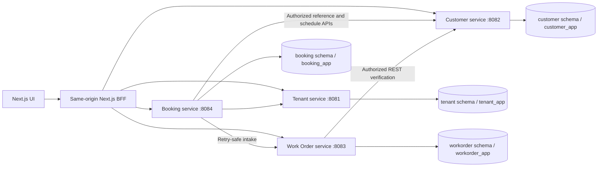

> Milestone 2 update: see [identity and authorization](identity-and-authorization.md). Redis now stores encrypted opaque sessions, and live Tenant membership checks replace signed branch/role claims. The diagram below describes original domain boundaries.

# MotorOS foundation

The local BFF forwards signed context but is not the only authorization boundary. Every Spring service validates issuer, audience, expiry and signature. Service repositories use explicit tenant predicates; work-order reads and writes additionally verify branch claims. Authorized staff can read completed vehicle history across the same brand, without permission to operate the originating branch.

Flyway creates each service's tables; Hibernate validates rather than creating schemas. PostgreSQL composite foreign keys prevent a vehicle linking to a customer from a different tenant. Optimistic locking makes status edits conflict instead of silently overwriting. Audits commit with domain changes. There is no cross-service distributed transaction: Work Order reads vehicle existence, then creates its own local record. Vehicle deletion is not implemented; a future deletion/retention workflow must account for this race.

Run components independently with their executable JAR and service-specific environment. See the root README. Credentialed SeaweedFS provides private local object storage. Optional LocalStack is reserved for later messaging; no queue producer or consumer is claimed. Redis now supports server-managed sessions, not permission caching.

Dependency versions are recorded in Maven and npm lockfiles. Next.js 16 needs Node >=20.9; verified host is Node 24. Spring Boot 3.5 supports Java 21. Primary references: [Next installation](https://nextjs.org/docs/app/getting-started/installation), [Spring Boot requirements](https://docs.spring.io/spring-boot/3.5/system-requirements.html).

Milestone 4 extends operations with booking, intake, tasks, inspections, qualification-backed quality review and private photos. See [workshop operations](workshop-operations.md) for concurrency, service coordination, development approval gates and recovery limits.
