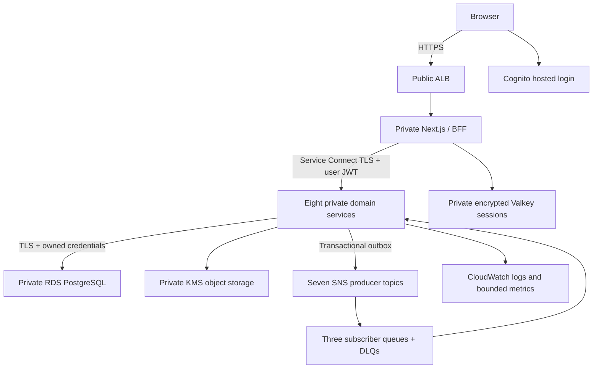

# MotorOS AWS deployment architecture

Milestone 7 prepares nine application deployments: the existing Next.js frontend/BFF and eight Java services. It does not create a second BFF, combine services, introduce Kubernetes, deploy AI, or claim an AWS installation exists.

Two public subnets hold the ALB and NAT infrastructure; two private application subnets hold tasks; two isolated database subnets hold RDS. Tasks receive no public IP. Public ingress terminates TLS at the ALB; its private target hop uses HTTP to the BFF. Inter-service traffic uses Service Connect TLS, not that public target hop. JWT verification and Tenant Service permissions still authorize each request independently of networking.

Staging uses one application replica, one NAT, single-AZ RDS and one cache node. Production prepares two application replicas, Multi-AZ RDS/cache and two NATs. Staging is not highly available. Database subnets have no internet route. The S3 gateway endpoint is selected; paid interface endpoints require a separate egress/cost review. NAT remains necessary for Cognito public endpoints, SES SMTP and approved external traffic.

Cloud profiles disable automatic Flyway, development financial approval, public Swagger and sensitive Actuator endpoints. Separate tasks run migrations without constructing a Spring application context. Runtime roles have business DML and read-only access to their own Flyway history; migrators own their schema. Cloud replicas run Flyway validation before constructing the application context and never run migrations. No cross-schema joins or foreign keys were added. ECS services initially have desired count zero; deployment automation starts them only after initialization and migrations succeed.

The reusable environment module composes the existing Cognito and messaging modules. `main.tfmodel.json` is its structured source; the checked-in generated HCL is the actual Terraform input and is scanned by Checkov/TFLint. The renderer uses the locked provider's public schema. Do not edit generated HCL independently of its model. Independent environment roots/state isolate staging and production; separate accounts remain preferable when available.

Source references: [ECS Service Connect](https://docs.aws.amazon.com/AmazonECS/latest/developerguide/service-connect.html), [TLS infrastructure role](https://docs.aws.amazon.com/aws-managed-policy/latest/reference/AmazonECSInfrastructureRolePolicyForServiceConnectTransportLayerSecurity.html), [S3 native state locking](https://developer.hashicorp.com/terraform/language/backend/s3).

## Capacity and tracing limits

Each default task has 512 CPU units and 1,024 MiB total. The application container receives 256 CPU units, a 768-MiB reservation and an 896-MiB hard limit, leaving 256 CPU units and 128 MiB for the managed Service Connect proxy. `service_sizes` permits independently reviewed Fargate-compatible overrides. Local application startup and API checks do not measure TLS-proxy throughput; staging load/soak and cache/database connection headroom are release gates. Eight pools at five connections require at least 40 connections per complete replica set; bounded autoscaling, migration and operator connections must also fit the live RDS limit. Raise task/database allocations and reprice if measurements require it.

Existing OpenTelemetry HTTP/event spans, propagated trace context and correlated JSON logs are preserved. CloudWatch receives bounded application metrics. An AWS X-Ray/ADOT trace exporter and an end-to-end cloud trace have not been configured or verified; log correlation must not be described as a verified X-Ray deployment.
